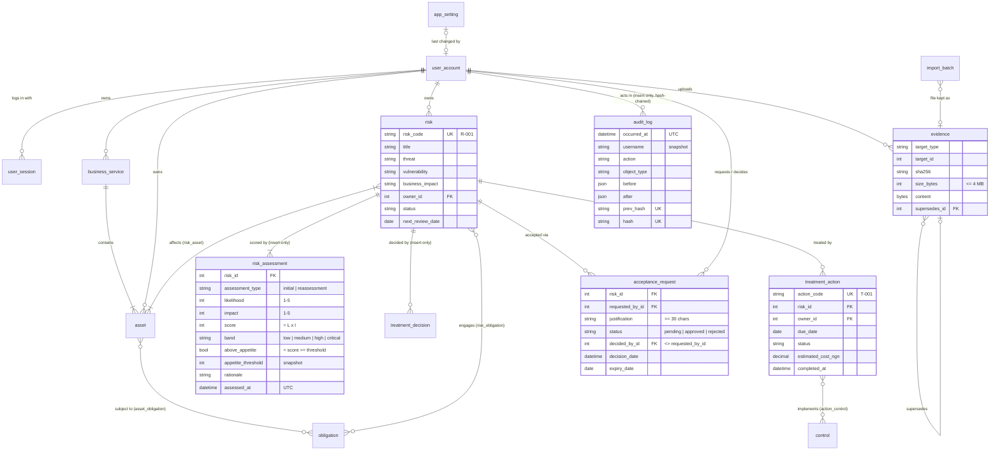

# RiskTrack data model

Source of truth: `app/backend/app/models/` and the Alembic migrations in `app/backend/alembic/versions/`. This page explains the design for the report (section 2, "database design"). Owner of the content: Ocen; report wording: Gilbert Obichere (WS4).

## Entity-relationship diagram

Evidence attaches to any record through `target_type` + `target_id` (risk, assessment, decision, action, acceptance, import batch), so the diagram shows it without a single foreign key.

## Tables (19)

| Area | Tables |
|---|---|
| People | `user_account`, `user_session` |
| Register | `business_service`, `asset`, `obligation`, `control`, `asset_obligation`, `risk`, `risk_asset`, `risk_obligation` |
| Scoring | `risk_assessment` |
| Treatment and acceptance | `treatment_decision`, `treatment_action`, `action_control`, `acceptance_request` |
| Records | `evidence`, `audit_log`, `import_batch`, `app_setting` |

## Rules the database enforces itself

The API enforces every rule; the database repeats the critical ones so that a bug, a script or a direct SQL session cannot break them.

| Rule | Mechanism | Brief / test |
|---|---|---|
| Likelihood and impact are 1 to 5 | CHECK | F2 / T02 |
| Score equals likelihood × impact | CHECK `score = likelihood * impact` | F2 / T01 |
| Band matches the score (1-4 low, 5-9 medium, 10-14 high, 15-25 critical) | CHECK | F2 / T03 |
| Appetite flag matches the threshold in force at the time | CHECK `above_appetite = (score >= appetite_threshold)` | F2 / T04 |
| One initial assessment per risk; reassessments unlimited | Partial unique index | F4 |
| Assessments, decisions, evidence and audit entries are never edited or deleted | BEFORE UPDATE/DELETE triggers (PostgreSQL function, SQLite RAISE) | F4, F7 / T11 |
| The audit chain cannot fork | `prev_hash` unique | F7 / T22 |
| The requester of an acceptance can never decide it | CHECK `decided_by_id <> requested_by_id` | F5 / T12 |
| Acceptance justification at least 30 characters; an approval has a decider, date and expiry | CHECK | F5 / T15 |
| A completed action records who, when and a note | CHECK | F3 / T08 |
| Evidence at most 4 MB, with a 64-character SHA-256 | CHECK | T27 |
| Asset names unique within a service (the import's natural key) | UNIQUE (name, service) | F8 / T26 |
| Only listed roles, statuses, strategies, bands, frameworks and regimes | CHECK `IN (...)` generated from the code's enums | all |
| A single settings row | CHECK `id = 1` | |

Rules needing other rows (a risk owner can't approve their own risk's acceptance, CISO/CRO failover, at least one asset per risk) are enforced by the API and tested there (phase P5).

**Known limit, stated honestly:** the database owner can drop a trigger. That is why the audit log is also hash-chained: any later change to an audit row breaks the chain and `verify-audit` reports it.

## Time

Timestamps are stored in UTC (`timestamptz` on PostgreSQL) and returned timezone-aware; naive datetimes are refused on write. Calendar dates (due, review, expiry) are plain dates evaluated in The Alajo's official zone, Africa/Lagos (see `PLAN.md` §2.7).

## Migrations

- `alembic upgrade head` builds the schema; `alembic downgrade base` removes it. Migrations use `DATABASE_URL_DIRECT` (Neon's non-pooled endpoint) when set.
- The baseline migration also creates the insert-only triggers and the default settings row (appetite 10, SLAs 30/90/180 days, reviews 30/90/180/365 days, zone Africa/Lagos).
- Reference data (framework controls, regulatory obligations) is loaded separately and idempotently: `python -m app.cli load-reference`.
- A test fails if the models and the migrations ever drift apart.
